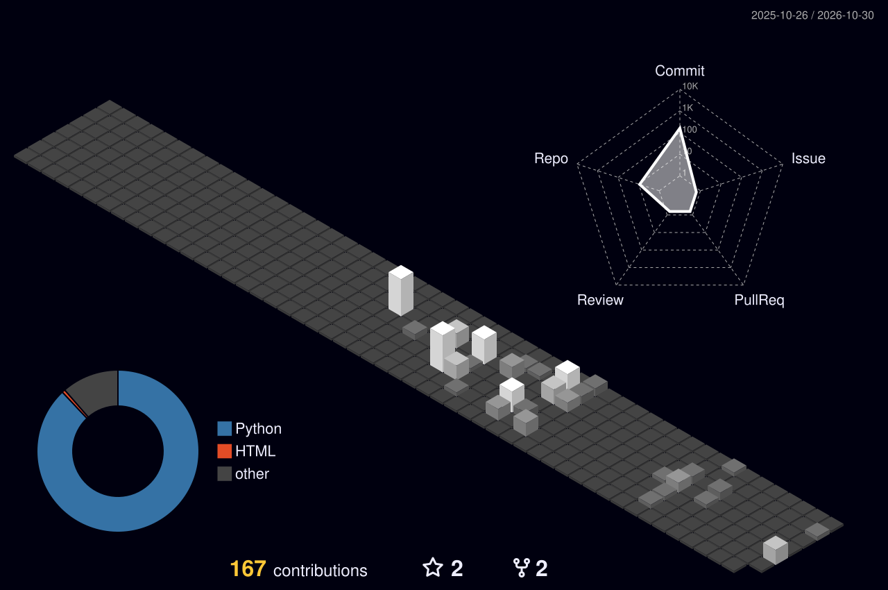

<h1 align="center">
  <b>Olá, sou o João!</b>
</h1>

Curso Engenharia Elétrica no [IFES](https://guarapari.ifes.edu.br), campus Guarapari, e sou aluno de pesquisa pelo [Lab Penguin](https://github.com/Lab-Penguin) e [LabSEA](https://github.com/Lab-SEA), onde tive a oportunidade de desenvolver projetos na área de controle, robótica e visão computacional. Atualmente, estudo algoritmos que implementam Deep Reinforcement Learning para controle de sistemas contínuos, especificamente, estruturando um modelo de função de recompensa no controle do sistema Carro-Pêndulo.
 

<!-- 

  

 -->

  
  
  
  
  
  

## Contato  

- Email: **joao.queirozst@gmail.com**
- LinkedIn: [João Pedro Queiroz](https://www.linkedin.com/in/joaopqdroqueirozs/)  

<b>📊 Estatísticas do GitHub</b>

 

  

  

  

  

